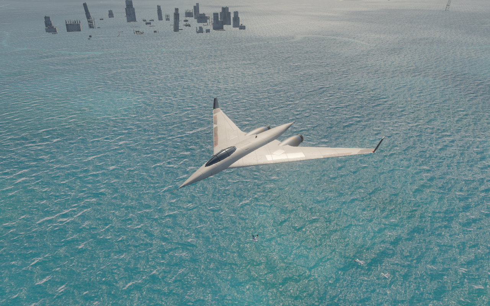
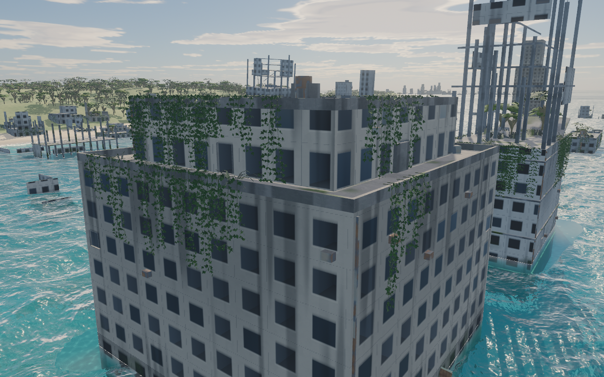

# Glider

A quiet flight over a drowned world. Take the controls, follow the music, and watch nature reclaim the cities below.

**[Take flight → glider.nachoestevo.com](https://glider.nachoestevo.com)**



## The experience

- An atmospheric ocean with waves, reflections, foam, and underwater ruins.
- Overgrown cities, tropical islands, birds, and a weathered glider.
- A continuous soundtrack, cockpit dialogue, and spatial environmental sound.
- A final glide as the music ends and the fuel runs out.



## Fly

| Control | Action |
| --- | --- |
| `W` / `S` or `↑` / `↓` | Climb / descend |
| `A` / `D` or `←` / `→` | Steer |
| `Shift` | Boost |
| `C` | Change camera |
| Scroll | Zoom |
| `H` / `M` | Hide interface / mute |
| `Space` | Skip the introduction |
| `I` / `F` | Credits / fullscreen |

On touch screens, drag to steer and climb. Gamepads are also supported. Leave the controls idle and the autopilot takes over.

## Run locally

Requires Node.js 22.12 or newer.

```sh
npm ci
npm run dev
```

```sh
npm test          # Geometry, quality, and ending checks
npm run build    # Production build in dist/
npm run preview  # Preview the production build
```

Built with **Three.js**, **Vite**, and procedural JavaScript geometry. Runs entirely in the browser; no API keys or backend are required. Rendering uses WebGL2 with adaptive resolution. Desktop browsers with hardware acceleration are recommended; performance varies by device.

## Credits

Created by [Ignacio Estevo](https://nachoestevo.com).

Inspired by [daymoon playlist’s 활공](https://www.youtube.com/watch?v=khnr4-ehwKA) and [Yishu 5’s illustration](https://www.artstation.com/artwork/b1rOn). Music by Tony Anderson, Ever So Blue, Thomas Bergersen, Jakob Ahlbom, and Lama House; mix and curation by daymoon playlist. The included music remains the property of its rights holders and is not covered by the code or asset licenses.

Ocean rendering adapted from [Ultra-Water](https://github.com/Humpalumps/Ultra-Water) (MIT). Textures and foliage from [ambientCG](https://ambientcg.com) and [Poly Haven](https://polyhaven.com) (CC0). Voices and sound effects generated with ElevenLabs. Full credits are available in the experience.

[Water license](public/licenses/ultra-water/LICENSE.txt) · [Third-party notices](public/licenses/ultra-water/THIRD_PARTY_NOTICES.txt)
